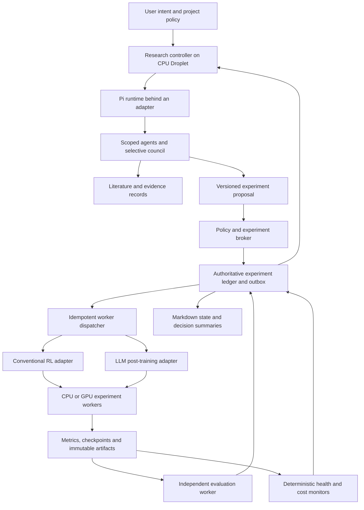

# Proposed architecture

Status: design, not implemented or deployment-tested. Read `reuse-plan.md` for the source-backed component choices and their limits.

## Recommendation

Use Pi as a candidate agent-runtime dependency, adapt selected Ouroboros governance and recovery patterns, and build a small research-specific control layer. Run the controller continuously on a Droplet. Execute training in separately managed workers through explicit adapters. Keep the design usable with one controller before adding distributed orchestration.

Pi's durable package is experimental, so isolate it behind an application-owned interface and qualify a pinned release. Neither repository supplies the domain-specific experiment validity, trainer integration, independent evaluation, and resource-admission policy this project needs.



## Separate authority from reasoning

The orchestrator proposes and explains actions. An application-owned broker validates and executes them. This boundary makes resource limits, experiment identity, and recovery behavior inspectable even when a model changes its mind or a prompt is misleading.

The broker permits routine actions within a configured project policy: approved tools, readable/writable resources, allowed workers, model and compute allowances, deadlines, maximum concurrency/depth, and data access. Once those limits are configured, the assistant should operate autonomously inside them. Scope changes require a policy update; model text or retrieved content cannot grant that authority.

Independent evaluation code and final held-out answers live outside experiment-author write access. Candidate evaluator changes can be proposed and tested, but cannot rewrite the measurement used to judge their own experiment. An evaluator defect invalidates affected results and produces a new evaluator version with an explicit re-evaluation plan.

Experiment authors also lack read access to final held-out answers until the evaluation policy permits release. Development feedback may guide exploration; final evaluation access is separately logged and limited. Isolation must enforce this separation in data access, not merely ask an agent to ignore answers it can read.

## Component responsibilities

| Component | Owns | Does not establish |
|---|---|---|
| Pi runtime adapter | Model calls, tool lifecycle, conversations, child tasks, context compaction, persisted agent work | Scientific validity, hard spend enforcement, remote job uniqueness |
| Research controller | Project queue, evidence packets, agent assignment, council decisions, next experiment choice | Truth merely through consensus |
| Experiment broker | Manifest checks, policy enforcement, reservations, commands, run state transitions | Correctness of arbitrary trainer code |
| Worker adapter | Launch, observe, checkpoint, cancel, reconcile, and collect a specific trainer/backend | Universal training semantics |
| Evaluator | Locked task metrics, controls, uncertainty calculations, claim-relevant comparisons | Novelty or acceptance at a conference |
| Artifact store | Configurations, datasets/references, raw metrics, checkpoints, logs, reports and checksums | A database transaction across a remote provider |
| Literature service | Source discovery, retrieval, versioning, claim support and update notes | Exhaustive knowledge of all research |

Use an application-owned `AgentRuntime` interface for submit, observe, cancel, child-task creation, usage and context references. Map it to the pinned Pi version. Run the TypeScript runtime in the controller and expose Python scientific operations as typed tools or a local worker service. Do not add both a Python agent framework and Pi as competing orchestrators. If Pi's experimental API fails qualification, retain the interface and substitute a simpler Pi AI/agent-core worker under the same controller.

The runtime's broker client is trusted application code; model-facing execution is not. Coding/shell tools execute under a separate identity or worker boundary without broker credentials, policy-write access, experiment-ledger access or privileged control sockets. They cannot execute arbitrary code in the controller process. The API must authenticate scoped requests and independently check policy, so an agent cannot bypass it by writing a file or calling a hidden shell command.

## State, ownership, and recovery

Keep two clearly distinguished stores initially:

- **Agent store:** Pi owns its conversations, tool records, task checkpoints, and derived usage. Use a separate database owned by one Pi process. Do not let application code modify Pi's internal tables.
- **Experiment ledger:** the broker owns projects, manifests, runs, actions, reservations, backend job references, evaluation records, and an append-only event log. Workers post events through its API; they do not write directly to the controller database.

The experiment ledger is authoritative for external actions and costs. Pi transcripts and Markdown are projections or references, not independent authorities. There is no assumed atomic transaction between the two stores. A Pi tool submits an action with an application-generated stable action ID; repeated calls return that action's existing outcome. After a crash, reconciliation repairs missing transcript projections from the ledger.

Bind action identity to the logical operation, for example `(run_id, operation, operation_revision)`, under a ledger uniqueness constraint. Persist or recover that identity before any external dispatch, and do not mint a new UUID each time a model calls the tool. The tool refers to an already registered run; intentional replication requires an explicit new run/replica record. Reusing an action identity with a different manifest digest or payload is an error. A crash after broker admission but before Pi stores the result must recover the same admitted operation.

Start with a single broker writer using SQLite transactions and a durable outbox. In one ledger transaction, verify policy, reserve the allowed exposure, record the command intent, and enqueue dispatch. A dispatcher sends it after commit. Record acknowledgement separately. This avoids a database commit claiming a job was launched before any request was sent, but it does not remove uncertainty when a remote launch succeeds and its reply is lost.

Use one service owner and an exclusive controller lock in the initial deployment. Read-only dashboards must remain read-only. Before adding failover or multiple schedulers, introduce leases with monotonically increasing fencing tokens that workers validate; a stale controller must not retain command authority. Move to a server database or distributed workflow engine only when measured concurrency or availability requirements justify it.

Use a storage configuration qualified for the required host-crash durability, backed by off-host backups and restore tests. Pi's observed main-branch SQLite default is WAL with `synchronous=NORMAL`; do not call that power-loss-proof. Verify what the chosen release exposes and how the whole stack behaves. A supervisor restart is not a substitute for durable storage.

### External launch protocol

1. Create `run_id` and `action_id`, a manifest digest, and a worker/backend idempotency key before dispatch.
2. Persist policy admission, cost reservation and launch intent in the ledger.
3. Send the request to an authenticated worker agent that records the idempotency key durably before spawning a trainer. Include the expected manifest digest, current authority token and worker-enforced deadline. Give the backend job/container a deterministic discoverable identity derived from the action, and verify its ownership and manifest when looking it up.
4. Return and persist the backend job ID and worker acknowledgement.
5. If a response is lost, mark the action `unknown` and query/reconcile using its key. Never issue a second launch just because the first request timed out.
6. Serialize creation for each action and reconcile on worker startup. A worker can crash after spawning but before recording the receipt; durable intent alone does not close this gap. Discover the existing deterministic job identity or hold the action if the backend cannot establish whether work started. Never treat a worker-local lock as an exactly-once guarantee.

This provides retry-safe behavior within a qualified worker/backend contract; it is not an unconditional exactly-once guarantee across every provider. Provisioning a worker VM and launching training are distinct actions with their own identities and recovery paths.

### Run state

```text
proposed -> validated -> admitted -> launching -> running -> evaluating -> complete
                          |             |           |
                          v             v           v
                        held          unknown   checkpointing -> stopped
                                                       |
                                            resumed or linked new run
```

Failures can occur at any nonterminal state and retain their last confirmed backend state. `unknown` means reconciliation is required, not that a job failed. `cancel_requested` is an operation in progress; only backend confirmation allows a run to become stopped. Preserve exit reason, partial results, interruption history, and any data or steps lost on resumption.

## Trainer contract and the two adapters

An adapter must expose `validate`, `estimate`, `launch`, `status`, `metrics_since`, `checkpoint`, `cancel`, `collect`, and `reconcile`, plus a capability declaration. Unsupported capabilities return an explicit unsupported result; a trainer without resumable checkpoints must not be advertised as restartable. Validate all inputs and outputs at the process boundary.

Every run binds code revision and dirty patch if any, environment image digest, dependencies, model/tokenizer versions, data lineage and split hashes, reward/evaluator versions, seeds and determinism settings, resource limits, stop policy, selection policy, and artifact destinations. Record nondeterminism instead of promising bitwise reproduction where it is unavailable.

**Conventional RL adapter:** target Gymnasium-style environments first, with one selected trainer for the first project. Expose observations/actions, termination/truncation, rollout budgets, environment count, evaluation episodes, reward components, policy checkpoints, and seed-specific results. Add another trainer only after the common contract works. If distributed RL becomes necessary, RLlib is a candidate; its own [fault-tolerance documentation](https://docs.ray.io/en/latest/rllib/rllib-fault-tolerance.html) distinguishes worker, environment and experiment recovery, which the adapter should preserve rather than flatten into a single retry flag.

**LLM post-training adapter:** target one selected training stack first. Expose base/reference/reward model identifiers, tokenization/template versions, prompt and task splits, rollout sampling, verifiers, reward components, optimizer state, distributed topology, and token/step budgets. A checkpoint may require optimizer/scheduler/RNG state and rollout state as well as weights; the contract must state what is actually resumable. Use separate evaluation tasks for intended capability, reward robustness, and regressions.

These adapters can share run lifecycle and observability without forcing all algorithms into one convergence heuristic. Supporting “whatever models” is a direction for expanding adapters, not a capability provided by the initial design.

For LLM evaluation, freeze decoding, sample count, token/tool budgets and pass@1/pass@k/selection semantics; additional inference must not masquerade as improved training. Preserve verifier pass/fail, malformed output, parse error, timeout and infrastructure error as distinct outcomes with explicit retry/penalty policy. Track the policy version that generated each rollout when collection and training are asynchronous. Evaluate substantive success separately from formatting or constraint compliance.

## Cost admission and stopping

Maintain separate ledgers for model-call cost, CPU/GPU allocation, storage and other charged services. Track settled charges, live reservations, unknown exposure, and unallocated headroom. Admission checks must be atomic across concurrent children. A child's allowance draws from its project and parent; retries and critique rounds consume the same durable budget.

For bounded LLM requests, reserve a conservative allowance using input size, maximum output, pricing snapshot and known ancillary charges. Reconcile provider-reported billing where available and keep estimates labeled. Unknown or late charges cannot simply release a reservation. For compute, bound requested resource count and duration, and retain cancellation headroom. An independent watchdog enforces deadlines if the model or controller hangs.

Enforce model admission at the actual provider-call boundary or an authenticated gateway shared by all agents. It must cover generation, compaction, internal retries, hooks, literature tools that call models, and tool-triggered calls. Per-tool checks on experiment launches are insufficient. Workers must not receive credentials that let them bypass the gateway. Verify that every call path in the selected Pi release goes through this control; if it cannot, do not claim that path is budget-enforced.

Worker/backend deadlines must function while the Droplet is unreachable. Trainer termination, artifact preservation and paid allocation release are separate steps. Use backend-enforced job limits and, where needed, an independent external resource reaper. Record the remaining billing exposure when an allocation cannot be released or its state cannot be confirmed.

These controls reduce overshoot but cannot guarantee a final invoice ceiling when external prices, billing, or cancellation latency are not bounded. State the enforceable bound precisely: admitted work, maximum concurrent exposure, or provider-enforced account cap. Use a provider-side spending control when available and verified; do not infer one from a dashboard budget setting. CPU/GPU instances may continue charging while idle, so stopping a trainer and releasing a paid allocation need separate policies and confirmed actions.

## Droplet deployment

Use one CPU Droplet for the controller, broker, scheduler and compact monitoring. A provisional starting envelope is 2–4 vCPU and 4–8 GB RAM for light single-user orchestration; this is an estimate to measure, not a sizing guarantee. Keep large datasets, model inference and training off that machine unless a pilot demonstrates they fit. DigitalOcean offers both CPU and GPU Droplets; the separation is an architectural choice, not a claim that Droplets lack GPUs. See [Droplet features](https://docs.digitalocean.com/products/droplets/details/features/).

Run the controller under a service supervisor with restart limits and alerts. Workers should execute code under a dedicated identity with bounded CPU, memory, disk, runtime, filesystem mounts and network access. Keep cloud-provisioning credentials in the broker; research code receives only narrowly scoped artifact and job credentials. A container that exposes the host's privileged socket does not provide the intended boundary.

Store irreplaceable artifacts and database backups off the controller. Worker-local scratch is a cache. DigitalOcean documents that GPU scratch disks are nonpersistent, excluded from snapshots, and without redundancy; do not leave the sole copy of a checkpoint there. See [GPU scratch disk](https://docs.digitalocean.com/products/droplets/how-to/gpu/use-scratch-disk/).

Use authenticated private communication where available, scoped worker registration, versioned images, health checks, disk limits, credential rotation, and an independently reachable stop control. The stop operation must enumerate foreground children, background tasks, queued jobs, active training and paid allocations. Its report distinguishes stopped, still-running and unknown resources. Backups need a tested restoration procedure and a stated recovery objective.

Stop first writes a durable project/global admission barrier, then revokes dispatch authority and enumerates/cancels existing work. Broker admission and workers check this barrier or a bounded authorization lease; automatic service restarts cannot clear it. A worker cut off from the controller may retain an unexpired lease, so stop is not instantaneous across a network partition: enforce a bounded lease/deadline and report that exposure. Only an authorized resume clears the barrier. Test the race between stop, queued dispatch and supervisor restart.

## Context that survives long projects

Use layered context: stable mission and constraints; current project state; accepted decisions; experiment manifests and outcomes; source/evidence records; and an append-only event history. Retrieve by project, hypothesis, run and claim IDs before broad semantic search. Embedding retrieval is optional until it solves a measured retrieval problem.

A task packet should include its objective, allowed actions, evidence references, assumptions, current configuration, outstanding objections, deadline, budget and expected output. A handoff must preserve unresolved contradictions and failed attempts. Summaries need source pointers and a revision date so an agent can recover omitted details.

Generate Markdown summaries from authoritative state where practical, and review factual consistency before treating them as current. Contradictory memory should be flagged and superseded explicitly. An agent's confident summary must never overwrite an immutable run result.

## Self-improvement

Permit proposals to change prompts, tools, policies and source code in isolated candidates. Qualify them against a held-out harness evaluation set, cost regressions, recovery tests, and project-policy checks before promotion. Require reproducible evidence tied to the candidate revision and retain rollback. A candidate cannot alter its own promotion criteria or grant itself broader authority.

Ouroboros already provides useful reviewed-evolution patterns; retain that distinction rather than assuming all of its self-modification is ungated. However, postpone automatic runtime promotion until ordinary experiments, evidence retention and recovery are dependable. Research autonomy does not require continuous self-rewriting.
